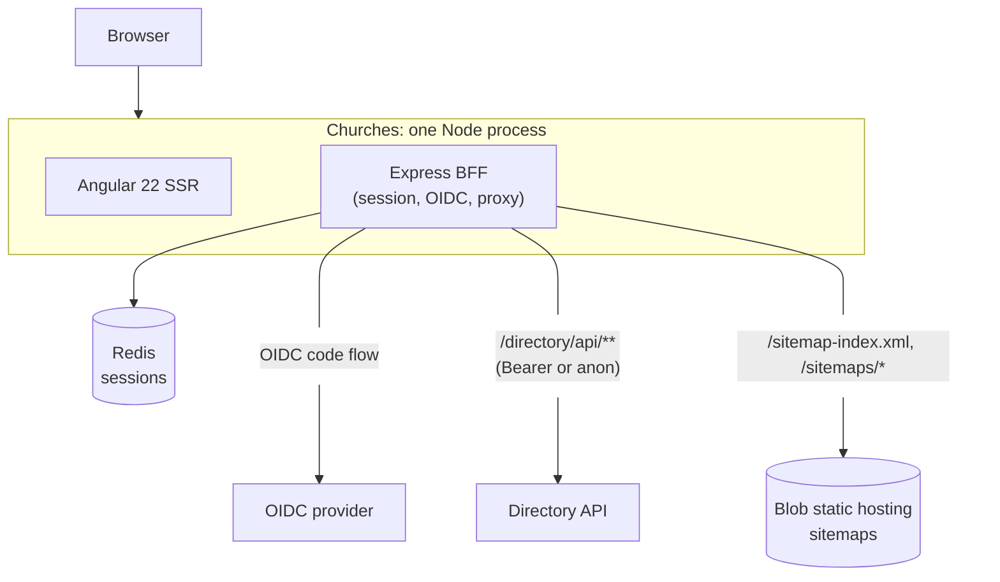
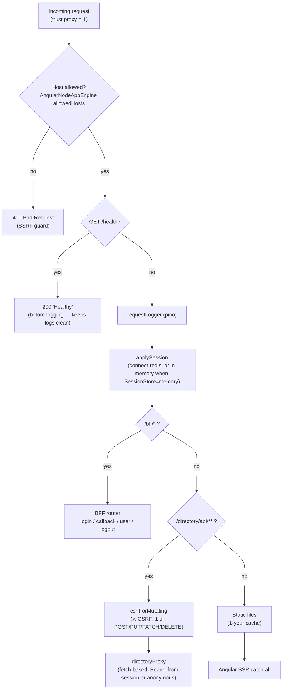
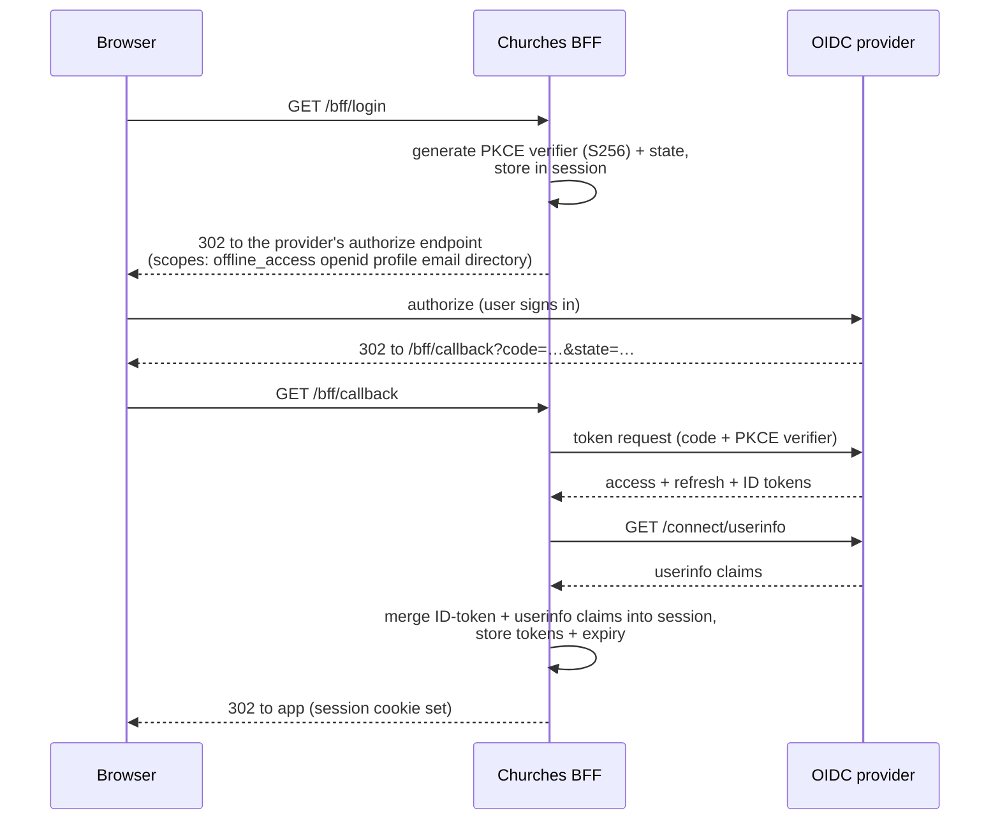
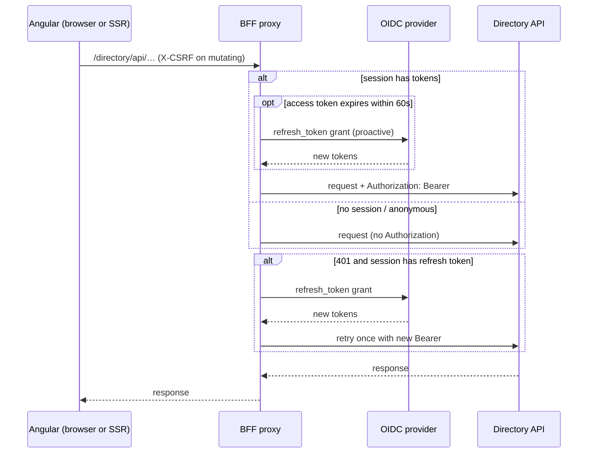

# Architecture

<!-- Keep flowchart/ER edges label-free (GitHub's Mermaid fails on labeled edges in hidden iframes); use the borderless label-node pattern seen in the diagrams below. -->

Churches is the web front end of a U.S. church-discovery service: an Angular 22 server-side renderer and an Express
Backend-for-Frontend (BFF) in one Node process. The BFF holds the user's OIDC session and proxies every data call to
the church Directory API, so the browser never holds an access token.

## System context

## The Churches app (UI + BFF)

One Node process does both server-side rendering and the backend-for-frontend. There is no .NET server in this repo: `src/server.ts` is an Express app that owns the session, the OIDC dance, and the proxy to the Directory API, then hands anything left over to the Angular SSR engine.

### Request path through the Express stack

Middleware mounts in this exact order (`src/server.ts`):

Two details here matter more than they look:

- **`allowedHosts` is an SSRF guard, and a host outside it is a hard 400.** `@angular/ssr` answers a request whose `Host` (or `X-Forwarded-Host`) is not allow-listed with `400 Bad Request` and the body `Header "host" with value "…" is not allowed`, while `/health` (Express, ahead of the engine) keeps answering 200. The allow-list is sourced per environment via `fileReplacements` (`src/environments/`); dev and CI allow only `localhost`. Any new production hostname must be added there.
- **The proxy is hand-rolled, not `http-proxy-middleware`.** `src/bff/proxy.ts` uses `fetch` directly because it needs token-aware behavior a generic proxy doesn't have (next section).

### Authentication

The BFF holds all tokens in the server-side session; the browser only ever has the `churches.sid` session cookie. Login is a standard OIDC authorization-code flow with PKCE via `openid-client` v6:

- The session cookie is `sameSite: 'lax'` — `Strict` breaks the OIDC callback (the redirect back from the provider is a cross-site navigation, so a Strict cookie wouldn't be sent and the callback couldn't find the session's PKCE verifier). `secure` in production.
- Sessions live in Redis via `connect-redis` unless `SessionStore=memory` selects `express-session`'s built-in `MemoryStore`, whose sessions don't survive a restart. **Nothing falls back silently**: without `SessionStore=memory`, a missing `RedisHost` or a missing or non-integer `RedisPort` throws at startup, and so does a missing `SessionSecret` (`src/bff/settings.ts`), so the process never runs on an in-memory store or a per-process secret by accident. `NODE_ENV` has no say in which store is chosen. It governs only whether the Redis socket uses TLS, and it makes `applySession` warn when `SessionStore=memory` is set in production.
- `/bff/user` returns the session's claims (requires the `X-CSRF` header) and appends a `bff:logout_url` claim carrying the session ID. A visitor with no session gets `200` with a `null` body: a non-2xx would put a line in the browser console that no script can suppress. The body must be `null` and never `[]`, because `AuthService` reads a non-null body as signed in, and `null` keeps "no session" distinct from "a session with no claims". This is the shape of Duende BFF's `AnonymousSessionResponse.Response200` option. `src/bff/routes.spec.ts` pins the exact body. `/bff/logout` verifies that sid matches the live session before doing RP-initiated logout at the provider. `/bff/login` and `/bff/callback` are browser-navigation redirects, not XHR/fetch calls, so they're exempt from the `X-CSRF` check — PKCE plus the `state` parameter protect them instead; `/bff/logout`'s CSRF protection is the server-issued `sid` query parameter rather than the header.
- Known quirk: `/bff/login` accepts but ignores the `returnUrl` query parameter that `authGuard` appends — after login you land on the app root, not the page that triggered the redirect.

### Proxying to the Directory API

Every data call from Angular goes to `/directory/api/**`, and the BFF forwards it with `fetch`:

This gives **UserOrNone parity** with the Directory API's auth model: authenticated users get their token attached, anonymous visitors get anonymous access to the anonymous endpoints — the same URL space works for both. The proxy buffers request bodies so the retry-after-refresh can replay them, strips hop-by-hop headers and `x-csrf` before forwarding, and enforces the CSRF header only on mutating methods.

### The Angular application

| Route | Rendered | Guard | Purpose |
|---|---|---|---|
| `/` | Server | — | Search landing page |
| `/churches` | Server | — | Results list (grid / list / map views) |
| `/churches/:slug` | Server | — | Church detail (+ inline curation forms for moderators) |
| `/contribute/:slug` | Client | `authGuard` | Submit a correction |
| `/admin/moderation` | Client | `modGuard` | Review corrections, crawl sources, merges |

The split is deliberate: anonymous routes are `RenderMode.Server` because they are the SEO surface; authenticated routes are `RenderMode.Client` because SSR has no session and would render a useless logged-out shell. `AuthService.initialize()` no-ops under `isPlatformServer` for the same reason.

- **Every route that needs data gets it from a resolver, and the two church-loading resolvers fail in opposite directions on purpose.** `churchDetailResolver` degrades to `null` so the route still activates and `NotFoundComponent` can render a real 404 against the URL the reader asked for (see the SEO section). `contributeChurchResolver` redirects to `/` and emits nothing, because a correction form for a church that cannot be loaded has no page to render at all.
- **The results pager omits Previous on the first page and Next on the last, rather than disabling them**, following the [USWDS pagination guidance](https://designsystem.digital.gov/components/pagination/). A disabled control leaves the reader to work out why it is dead, and would identify "Previous" as a link on one page and a button on another. The page the reader is on is already stated by the range indicator and `aria-current="page"`. Each page-number link carries `aria-label="Page N"`, so a screen reader announces a page rather than a bare number. `church-list.component.spec.ts` pins all three, and the synthetic walker offers a page turn only when its control is present.
- **Zoneless** change detection (`provideZonelessChangeDetection()`) with hydration + event replay.
- `AuthService` exposes signals; `hasModerationScope` is true when the claim `churches.mod === 'true'`. `authGuard` hard-navigates to `/bff/login` (a full page load — the login flow is server-side); `modGuard` returns a UrlTree to `/`.
- **That claim reaches the browser from the access token.** `churches.mod` is attached to the `directory` API scope and to no identity resource, so it is absent from the ID token and from userinfo. `/bff/callback` merges `tokens.claims()` and `fetchUserInfo(...)` with `accessTokenClaims(...)`, which decodes the access-token payload and copies a short allowlist — currently just `churches.mod`. Server-side enforcement in Directory does not depend on this merge; the browser's moderation UI does. The E2E suite mocks `/bff/user` wholesale and cannot detect which path the claim arrived by; the discriminating test is in `src/bff/routes.spec.ts`.
- One HTTP interceptor of our own: `appInterceptor` adds `X-CSRF: 1`, a per-request `X-Request-ID`, and `withCredentials`, and during SSR forwards the incoming cookie to same-origin requests. Relative URLs are resolved during SSR by Angular's own server platform (`provideServerRendering` registers it), so the request keeps the relative URL the browser will use.
- **Server-rendered API responses reach the browser through Angular's HTTP transfer cache**, so hydration does not fetch them again. The cache key is method, response type, URL, body and parameters, never headers, so a URL rewritten before the cache sees it would never match the browser's. `withHttpTransferCacheOptions` opts in credentialed and cookie-carrying requests, because `appInterceptor` marks every request that way. That is safe because the transfer state is per render (one user's data lands only in that user's own HTML), signed-in HTML is `Cache-Control: no-store`, and a response that sets a cookie or is an error is never cached. `GET /bff/user` opts out with `{ transferCache: false }`, so the browser always asks for its own session. `e2e/features/server-rendered-pages.feature` pins both halves: hydrating a server-rendered list issues no directory request, and a client-side navigation afterwards still does.
- Maps are Leaflet, loaded via dynamic import and guarded with `isPlatformBrowser` — Leaflet touches `window` and would crash SSR.

### SEO

`SeoService` (`src/shared/seo.service.ts`) sets title, meta description, canonical, Open Graph, and Twitter tags per page; detail pages additionally emit a JSON-LD `@graph` containing schema.org `Church` and `BreadcrumbList`. All of it renders server-side on the public routes. The sitemap files themselves are *not* generated by this app: a separate job writes them to blob static hosting as a `sitemapindex` blob plus one gzip-compressed `urlset` blob per 50,000-URL chunk, and this app serves all of it under its own origin, via `src/bff/sitemap.ts`: `GET /sitemap-index.xml` fetches and buffers the index blob, and `GET /sitemaps/:file` fetches and buffers a chunk blob after strictly whitelisting `:file` against `^sitemap-\d+\.xml\.gz$` before resolving any blob URL from it (the same SSRF-safe `new URL(path, base)` resolution `directoryProxy` uses for `DirectoryApiAddress`, keyed off the `SitemapBlobBaseUrl` config value). Both routes buffer the full response and set an explicit `Content-Length` rather than streaming it through as `Transfer-Encoding: chunked` — chunk files are gzip-compressed down to a few hundred KB, small enough to buffer safely. `public/robots.txt` points crawlers at `/sitemap-index.xml`.

`NotFoundComponent` serves both the catch-all route (`{ path: '**' }`) and a church slug that fails to resolve, and it does two SEO-specific things beyond rendering a message: it sets a real HTTP 404 during SSR via `RESPONSE_INIT`, and it sets a `noindex` robots tag. Without the status code a crawler receives 200 with "not found" content — a soft 404, which Google treats as a quality signal against the whole site rather than as a missing page.

> **Hostname note:** a sitemap or sitemap index must be served from the same host as the URLs/sub-sitemaps it references, or crawlers discard every entry. The URLs inside are built from the base URL the sitemap job is given, so `robots.txt`'s `Sitemap:` line and the `/sitemap-index.xml` + `/sitemaps/:file` routes all need to agree with it. Once a custom domain is bound to the app, all of it should move to it together.
>
> **Gzip note:** chunk files are served as the `.xml.gz` resource itself — `Content-Type: application/gzip`, no `Content-Encoding` header — matching Google's documented convention of fetching a resource literally named `.xml.gz` and decompressing it because of what it is, not via negotiated HTTP compression. Nothing in the chain (the blob upload, Node's `fetch`, the Express response) may apply transparent gzip semantics, or the crawler receives mismatched bytes.

---

## What the app relies on

- **The Directory API.** Routes are unprefixed (`/search`, `/denominations`, `/churches/{slug}`, the moderation and
  crawl-source routes), anonymous for reads and bearer-protected for writes. A token carrying the `directory` scope may
  submit a correction; moderation requires the `churches.mod` claim, which the provider attaches to the `directory`
  scope's access token.
- **The OIDC provider.** A confidential client (`ChurchesClientId`/`ChurchesClientSecret`) using code + PKCE with
  `offline_access`, whose registered redirect URI is `<origin>/bff/callback`.
- **Sitemap blobs** under `SitemapBlobBaseUrl`: `sitemap-index.xml` and `sitemaps/sitemap-{n}.xml.gz`, written by
  whatever job generates them.

## Hosting

Linux Azure App Service, Node 24, with a system-assigned managed identity. The startup command is
`node --import ./instrumentation.mjs dist/churches.client/server/server.mjs`. Every setting reaches the process as an
App Service setting; the secret ones (`ChurchesClientId`, `ChurchesClientSecret`, `RedisPassword`, `SessionSecret`,
`ElasticsearchUsername`, `ElasticsearchPassword`) hold a `@Microsoft.KeyVault(SecretUri=...)` reference that the
platform resolves through the managed identity before the app starts, so the app holds no Key Vault SDK. Telemetry is
OTLP traces and metrics to `AlloyEndpoint` (`/health` excluded) and `pino` logs to Elasticsearch
(`logs-app-churches`). Testing strategy: [TESTING.md](TESTING.md); design rules: [DESIGN.md](DESIGN.md).
